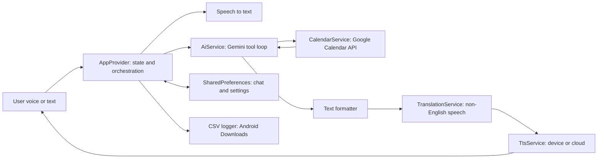

# AI Calendar Assistant

An **agentic, voice-first calendar copilot** that doesn’t just chat about your schedule, it **acts on it**.

This project started as “ChatGPT for my calendar.”  
That idea stayed the same. The architecture is now far more advanced.

## At A Glance

- Natural language + voice interface over real Google Calendar operations.
- Android-first runtime (Firebase options and app permissions currently configured for Android).
- Gemini model with tool-calling (create, update, delete, list, free/busy, find slots, colors).
- Guardrailed mutation pipeline: retry logic + post-action verification against Calendar state.
- Continuous hands-free loop: listen -> reason -> execute -> speak -> listen again.
- Debug-first developer UX: execution traces and function calls visible in-chat (debug builds).

## What Makes This Different

Most “AI calendar apps” generate text.  
This one runs a **closed-loop action engine**:

1. Understand request.
2. Call tools.
3. Validate outcomes.
4. Recover from failures.
5. Only then commit to the user-facing answer.

It is deliberately built like a small agent runtime, not a prompt wrapper.

## Current Architecture



## Agent Runtime (The Core Genius)

Inside `AiService`, the assistant runs a bounded tool loop (`maxAgentCycles = 12`) with safety rails:

- **Function-calling tools** include:
  - `addEvent`, `updateEvent`, `deleteEvent`
  - `listEvents`, `getEventById`
  - `getFreeBusy`, `findFreeSlots`
  - `getEventColors`
- **Conflict-first policy** is encoded in the system prompt:
  - Before time mutations, inspect overlaps first.
  - If conflicts exist, ask user to pick a resolution path.
- **Mutation guardrails**:
  - Retry transient/recoverable tool failures.
  - Verify create/update/delete by re-fetching event state.
  - Re-run verification flow when results are inconclusive.
- **Availability integrity**:
  - If user asks for free time, runtime enforces actual `findFreeSlots` usage before final answer.
- **Color intelligence**:
  - Human color names (`red`, `lavender`, `blue`) map to Google Calendar color IDs.
  - Hex matching is supported via real color metadata lookup.
- **Advanced patching**:
  - Supports JSON patch-like updates through `advancedFieldsJson` for non-trivial event fields.

## Calendar Engine

`CalendarService` is not a thin wrapper. It handles practical complexity:

- Auth via service account credentials.
- Multi-calendar access with cached accessible calendar IDs.
- Event-to-calendar indexing so follow-up updates/deletes target the correct calendar.
- Recurring instance-aware deletion behavior.
- Full event payload support:
  - attendees, reminders, recurrence, visibility, transparency, source metadata, all-day handling, advanced fields.
- Deterministic free-slot finding:
  - merges busy ranges across calendars,
  - applies day-window constraints,
  - enforces minimum duration,
  - returns actionable slot windows.

## Voice + Language Stack

- **STT**: streaming/partial recognition into live draft input.
- **TTS**:
  - Device TTS mode.
  - Cloud TTS mode through a configurable endpoint (`assets/config.json`).
  - Automatic fallback to device TTS if cloud synthesis fails.
- **Translation for speech output**:
  - Detects non-English segments.
  - Translates to English for cleaner TTS delivery.
  - Caches translated segments for repeated phrases.

## Product Experience

- WhatsApp-like chat UX with markdown rendering for model responses.
- Model switching at runtime (Gemini 2.5 and Gemini 3 preview variants).
- TTS engine switching at runtime (device/cloud).
- Interrupt button while thinking.
- Persisted conversation context with versioned invalidation.
- Debug drawer per assistant message (prompt, execution trace, tool calls, raw response).

## Repo Map

- `google_calendar_ai_agent/lib/presentation/*` -> UI and state orchestration.
- `google_calendar_ai_agent/lib/services/*` -> AI runtime, calendar integration, speech/translation stack.
- `google_calendar_ai_agent/lib/core/*` -> prompt, constants, formatting, logging utilities.
- `google_calendar_ai_agent/test/*` -> widget/unit coverage for critical behaviors.
- `google_calendar_ai_agent/functions/*` -> Firebase Functions scaffold for cloud-side expansion.

## Safe Testing (No Production Calendar Writes)

The test suite is now built to run against injected **fake services** instead of real calendar/AI/TTS backends:

- `AppProvider` supports dependency injection for calendar, AI, TTS, STT, and translation services.
- Tests use in-memory fakes from `test/support/fakes.dart`.
- Auto-listening and CSV logging are disabled in tests for deterministic, non-interactive runs.

Recommended commands:

```bash
# from google_calendar_ai_agent/
flutter test
flutter test --coverage
flutter test test/e2e/app_web_flow_test.dart -d chrome
```

Notes:

- Use `-d chrome` for web-style E2E widget flow testing.  
  `--platform chrome` can hang on some Flutter setups.
- These tests do **not** mutate your production calendar because they never call live `CalendarService` integrations.

## Guarded Production Calendar Test

There is also a real integration suite that calls the live Google Calendar API with strict write guards:

- Writes are constrained to **January 2027** only.
- Test-created event titles must include `test_event_in_`.
- Cleanup only removes events that match that title pattern in that month.

Run it explicitly (it is skipped by default):

```powershell
# from google_calendar_ai_agent/
$env:RUN_REAL_CALENDAR_TESTS='true'
flutter test test/playground/calendar_real_jan_2027_test.dart -r expanded
```

## Why There Is No Install Guide

This is a **private personal system**, not a plug-and-play open-source package.

It depends on private credentials/configuration (calendar access, Firebase project wiring, cloud endpoints, personal preferences), so the README focuses on **architecture and ideas**, not “clone + run.”

## Demo Video

<a href="https://www.youtube.com/watch?v=GhVEaJZW7uU" target="_blank">
    
</a>

## Vision

Today: a personal AI scheduler with real execution reliability.  
Tomorrow: the same architecture can power customer-facing booking agents, internal scheduling copilots, and vertical assistants where conversational UX must still produce deterministic operational outcomes.

## Disclaimer

Personal project. Private APIs/configuration. Not intended for general distribution in its current form.
