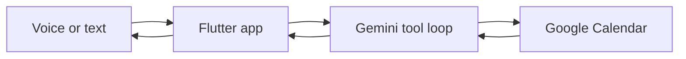

# AI Calendar Assistant

A personal assistant with a real voice and a real calendar. You talk to it the way you would talk to ChatGPT. It answers by reading and changing your Google Calendar.

I built the whole thing myself: the Flutter app, the Gemini tool loop, the Calendar integration, and the hands-free voice path. It is the project I use every day, not a demo that stops at a chat bubble.

[Five-minute demo](https://www.youtube.com/watch?v=GhVEaJZW7uU)

## What you can ask

- "What's my week looking like?"
- "Find a 2-hour free slot next week for lunch at noon."
- "Push my next meeting by an hour."
- "Add a green course block every Sunday in June, 12:30 to 3:30."

It can list, create, move, and delete events. If a time overlaps something already on the calendar, it says so and asks how to resolve it instead of silently double-booking you.

## Why it is more than a chatbot

Most calendar bots generate a polite sentence. This one has to be right, because the sentence is followed by a write to a live calendar.

1. You speak or type.
2. Gemini decides which calendar tool to call.
3. The app runs that tool against Google Calendar.
4. It reads the event back and checks that the change actually landed.
5. It speaks the result, then listens for the next request.

A free-time question is answered from real open slots, not from a guess. A color like "green" is mapped to a real Calendar color. After a create, update, or delete, the app does not tell you it worked until the calendar agrees.

## What I built

| Piece | What it does |
| --- | --- |
| Flutter app | WhatsApp-style chat, voice button, interrupt, model picker |
| Gemini tool loop | `listEvents`, `addEvent`, `updateEvent`, `deleteEvent`, `getFreeBusy`, `findFreeSlots`, `getEventColors` |
| Google Calendar API | Service-account access across the calendars I use, including recurring events |
| Voice | On-device speech-to-text, device or cloud text-to-speech, English speech when the reply is not English |

The loop is bounded. Every tool result is checked. If a call fails, the assistant retries when the error is recoverable, then tells you the real blocker instead of inventing a success.

## On the phone

- Hands-free: listen, act, speak, listen again.
- Interrupt while it is thinking or talking.
- Switch the Gemini model or the speech engine without restarting.
- In a debug build, each reply can show the prompt, the tool calls, and the trace. That is how I catch a bad calendar write before I trust it.

## Where it can go

The same shape is a booking agent: a person talks, the assistant checks a real calendar, and the appointment only exists after the API says it does. I built it for my own schedule first, because that is the only way to find out whether the agent is actually reliable.

## Notes

This is a personal project. Calendar access, Firebase, and speech keys stay private, so the repo is not a clone-and-run app. Behavior is covered by unit and widget tests that use fake calendar and model services. The live calendar suite is opt-in and only writes tagged events in January 2027. See [TESTING.md](TESTING.md).
